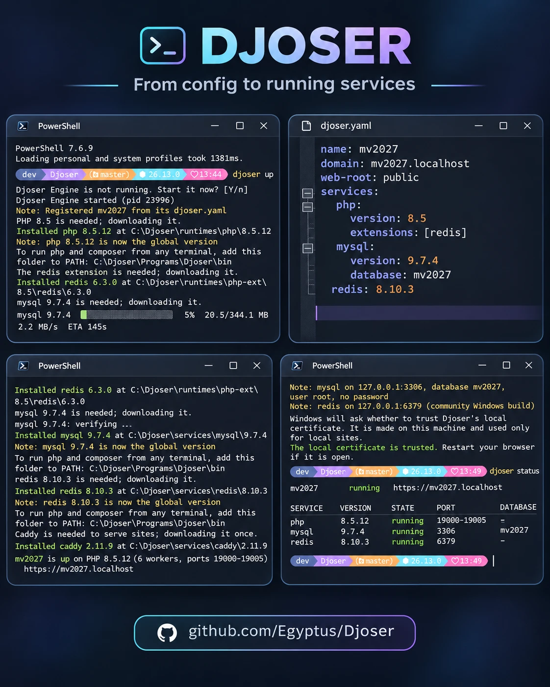
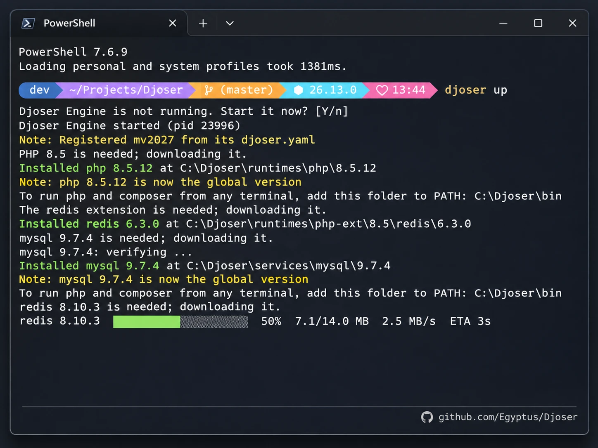
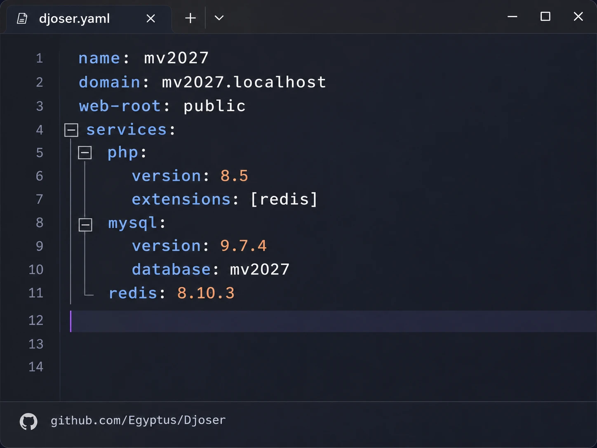
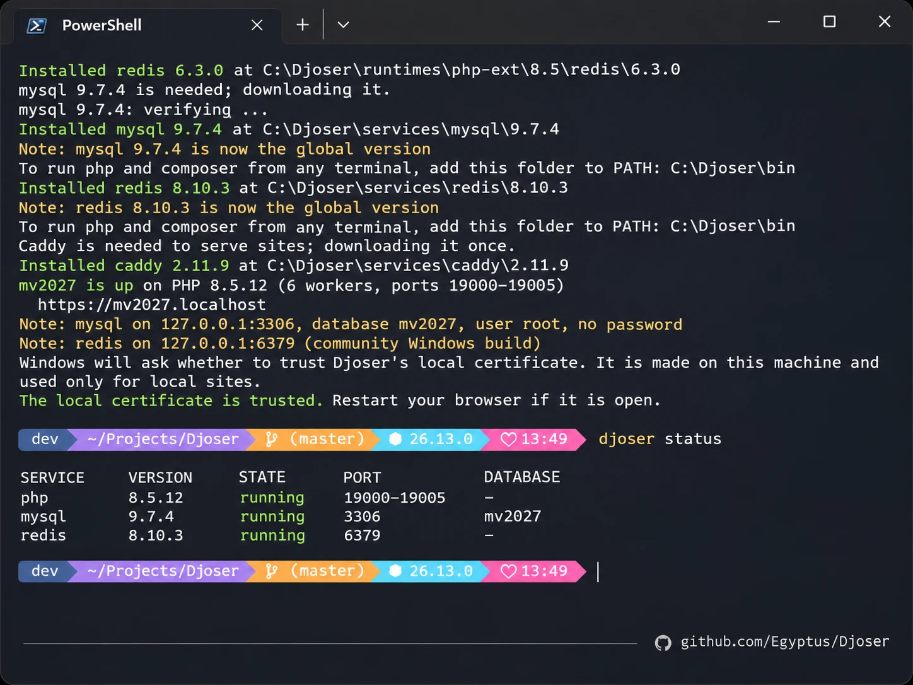
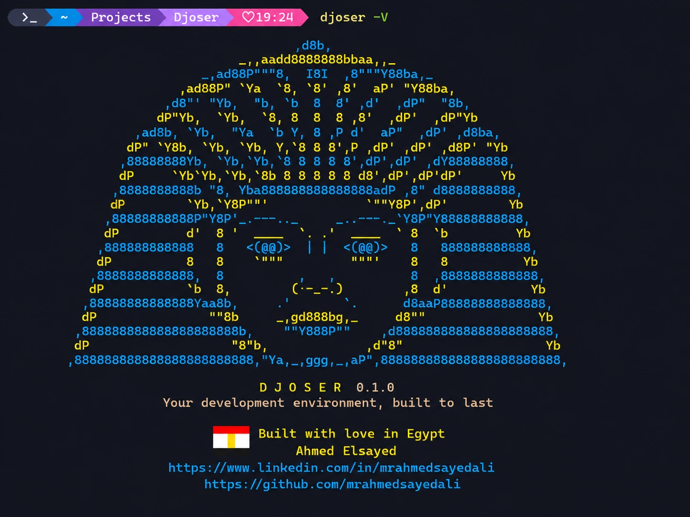

<div align="center">



**A native, Windows-first developer environment manager for PHP and Laravel.**

Per-project PHP and Node.js, local HTTPS sites, databases, S3, mail and background workers, without Docker, WSL or touching the PHP already on your machine.


[](https://github.com/Egyptus/Djoser/releases)

### [Download for Windows](https://github.com/Egyptus/Djoser/releases/latest)

</div>

> Djoser is at an early stage. Expect changes between versions.

## Contents

- [Why Djoser](#why-djoser)
- [Install](#install)
- [A Laravel project from zero](#a-laravel-project-from-zero)
- [djoser.yaml, every key](#djoseryaml-every-key)
- [djoser.yaml examples](#djoseryaml-examples): [a large Laravel app](#a-large-laravel-app), [Next.js](#nextjs), [a plain page](#a-plain-html-or-php-page)
- [Every command](#every-command)
- [Sites, HTTPS and addresses](#sites-https-and-addresses), [another domain: the hosts file](#another-domain-the-hosts-file)
- [Databases and backups](#databases-and-backups)
- [Scripts and workers](#scripts-and-workers)
- [djoser deploy (experimental)](#djoser-deploy-experimental)
- [When something is wrong](#when-something-is-wrong)
- [What runs today](#what-runs-today)
- [This repository](#this-repository)

## Why Djoser

- **One file per project.** `djoser.yaml` says what a project needs, and `djoser up` makes it true.
- **Versions side by side.** Every project uses its own PHP, Node.js, MySQL or PostgreSQL version.
- **Real HTTPS.** Each project gets its own `https://name.localhost` address, and subdomains if you want them.
- **Background work that stays up.** Queue workers, the scheduler and `npm run dev` restart when they stop.
- **No administrator rights.** Djoser installs for your user only, and everything it downloads stays in one folder.
- **Your data stays.** `down`, `remove` and `uninstall` never delete a database, and backups live outside Djoser.

## Install

Download the installer from the [latest release](https://github.com/Egyptus/Djoser/releases/latest) and run it. It offers two options:

| Option | Default | What it does |
|---|---|---|
| Add Djoser to `PATH` | On | `djoser` works in any new terminal |
| Add the tools to `PATH` | Off | `php`, `composer`, `node`, `npm`, `mysql` and the others work in any new terminal, with each project's versions. If another copy is already on `PATH`, the one listed first is used |

The installer is not signed yet, so Windows or your antivirus may warn before running it. Choose **More info**, then **Run anyway**, and compare the file with the SHA-256 in the release notes.

To update, run `djoser self-update`, or run the new installer yourself. Either way Djoser stops first and keeps your projects and databases.

While Djoser runs, `https://djoser.localhost` (and `http://127.0.0.1`) shows a welcome page with this guide.

## A Laravel project from zero

From an empty folder to a site with PHP, MySQL, Redis, S3 storage, a mail inbox, queue workers, the scheduler and Vite. To add Djoser to a project you already have, start at step 3 inside its folder.

### 1. Get PHP, Composer and Node.js

```powershell
djoser list php                    # the PHP versions you can install
djoser install php 8.5             # the newest 8.5 patch, checked against its published hash
djoser install composer latest
djoser install node 22
djoser use php 8.5 --env           # the PHP used outside projects (optional)
djoser use node 22 --env
djoser runtimes                    # what is installed now
```

The first version of each you install becomes the default outside projects by itself.

### 2. Create the project

```powershell
cd D:\Sites
djoser composer create-project laravel/laravel shop
cd shop
```

### 3. Describe it

```powershell
djoser init
```

`init` asks for the name, the address, the folder the site is served from and the PHP version, with the right answer already filled in for a Laravel app. To answer from the command line instead:

```powershell
djoser init --name shop --domain shop.localhost --root public --php 8.5 -y
```

It writes `djoser.yaml` with four PHP settings and six scripts. Open it and add the services the project needs:

```yaml
name: shop
domain: shop.localhost
web-root: public
services:
  php:
    version: 8.5
    extensions: [redis]          # the PHP extension that talks to Redis
    ini:
      memory_limit: 512M
      upload_max_filesize: 64M
      post_max_size: 64M
      max_execution_time: 120
  node: 22
  mysql:
    version: 8.4
    database: shop
  redis: 8.4                     # the Redis server itself
  rustfs: 1.0                    # S3 storage, with a bucket named shop
  mailpit: 1.33                  # every mail the app sends lands here
scripts:
  queue: php artisan queue:work --memory=512 --max-time=3600
  schedule: php artisan schedule:work
  dev: npm run dev
  build: npm run build
  test: php artisan test
  fresh: php artisan migrate:fresh --seed
workers:
  - queue: 2
  - schedule
  - dev:
      startup: false             # start it when you want it: djoser workers start dev
```

### 4. Start it

```powershell
djoser up
```

The first run downloads what is missing (PHP extensions, MySQL, Redis, RustFS, Mailpit and Caddy), starts them, and offers to trust the local certificate so browsers accept the site.



It ends with the address and how to reach each service:

```text
shop is up on PHP 8.5.12 (6 workers, ports 19000-19005)
  https://shop.localhost
Note: mysql on 127.0.0.1:3306, database shop, user root, no password
Note: redis on 127.0.0.1:6379 (community Windows build)
Note: rustfs on 127.0.0.1:9000, console http://127.0.0.1:9001, bucket shop, key rustfsadmin / rustfsadmin
Note: mailpit on 127.0.0.1:1025, inbox http://127.0.0.1:8025
Note: 3 workers running; see them with djoser workers and djoser logs
Note: 1 worker waits for: djoser workers start <name>
```

### 5. Connect Laravel

```powershell
djoser env sync
```

Djoser compares `.env` with what it runs and shows each difference as two lines you can copy: the line you have, commented out in red, and the line it expects, in green.

```text
#DB_CONNECTION=sqlite
DB_CONNECTION=mysql
#DB_PORT (missing)
DB_PORT=3306
```

It then asks `Update .env? [y/N]`. Only `y` or `yes` changes the file, and only those lines. It covers the database (`DB_*`), Redis (`REDIS_HOST`, `REDIS_PORT`), mail (`MAIL_MAILER`, `MAIL_HOST`, `MAIL_PORT`), S3 (`AWS_*`) and `APP_URL`. Then choose what Laravel uses them for:

```env
CACHE_STORE=redis
QUEUE_CONNECTION=redis
SESSION_DRIVER=redis
REDIS_CLIENT=phpredis
REDIS_PREFIX=shop_
FILESYSTEM_DISK=s3
```

Projects using the same Redis version share one server, so give each its own `REDIS_PREFIX`.

### 6. Prepare the app

```powershell
djoser composer require league/flysystem-aws-s3-v3   # for S3 storage
djoser artisan migrate
djoser artisan storage:link
djoser npm install
djoser run build
```

Open `https://shop.localhost`.

### 7. Watch it run

```powershell
djoser status                   # services, workers, failed jobs, what changed in djoser.yaml
djoser status -w                # the same, redrawn every 2 seconds until Ctrl+C
djoser workers start dev        # Vite, for hot reload while you work
djoser logs queue -f            # follow the queue workers' log
djoser jobs                     # failed queue jobs, asked of Laravel
djoser jobs retry all
djoser tool db                  # HeidiSQL on the shop database
```

The inbox is at `http://127.0.0.1:8025` and the S3 console at the address `up` printed.

### 8. Keep it safe and share it

```powershell
djoser db backup                # one file per database, in Documents\Djoser\Backups\shop
djoser share                    # a temporary public address, until Ctrl+C
djoser down                     # stop everything the project runs
```

## djoser.yaml, every key

Edit the file and run `djoser up` to apply it; `djoser status` says when the file changed since the last `up`. You only write what you need: `mysql: 8.4` alone is enough. A key that has no effect where it is written is reported by `up`, and an unknown one is a warning.

### The project

```yaml
name: shop                     # default: the folder's name
domain: shop.localhost         # default: <name>.localhost
aliases: [www, api]            # more subdomains of the domain; "*" serves any, for multi-tenant apps
web-root: public               # default: public for Laravel, else the folder holding index.php or index.html
tls:                           # default: Djoser's local certificate
  cert: certs/shop.pem         # your own certificate and key, relative to the project; they must cover the aliases
  key: certs/shop-key.pem
backups: D:/Backups/shop       # default: Documents\Djoser\Backups\<name>; relative to the project or absolute
services:                      # see below
scripts:                       # see below
workers:                       # see below
```

A version is a line such as `8.5` or an exact one such as `8.5.12`. Servers are shared by projects, with one database per project, on `127.0.0.1` only; `port:`, `data:`, `dedicated: true` or `settings:` give a project its own server, which starts with empty data.

### php

```yaml
php:
  version: 8.5                 # a line such as 8.5, or an exact 8.5.12
  extensions: [redis, xdebug]  # default: none beyond what ships with PHP
  ini:                         # default: PHP's own values; djoser init writes these four
    memory_limit: 512M
    upload_max_filesize: 64M
    post_max_size: 64M
    max_execution_time: 120
```

`ini` takes any `php.ini` setting except `extension`, `zend_extension`, `extension_dir`, `curl.cainfo` and `openssl.cafile`. Extensions Djoser can download: `djoser list extensions`.

### node

```yaml
node: 22                       # a line such as 22, or an exact 22.23.4
```

Without `node:`, Djoser reads the project's `.nvmrc`, then `.node-version`, as nvm and fnm do: `22`, `v22.11.0`, `lts/*`, `lts/iron` or `node`. A version they name that is not installed is an error that names the file; Djoser never runs another one instead.

### mysql and mariadb

```yaml
mysql:                         # or mariadb:
  version: 8.4                 # mysql: 8.0, 8.4, 9.7   mariadb: 10.11, 11.4, 11.8, 12.3, 13.0
  database: shop               # default: the project's name, - becomes _
  port: 3306                   # default: shared server from 3306; setting it gives the project its own
  data: D:/Data/shop-mysql     # default: <home>\data\mysql-8.4; the folder must exist
  dedicated: true              # default: false
  settings:                    # passed as --name=value; gives the project its own server
    max_connections: 500
    sql_mode: STRICT_TRANS_TABLES,NO_ZERO_DATE
    innodb_buffer_pool_size: 512M
    character_set_server: utf8mb4
```

User `root`, no password, `127.0.0.1` only. Djoser sets `datadir`, `port`, `bind_address`, `socket`, `console`, `mysqlx` and `no_defaults` itself.

### postgres

```yaml
postgres:
  version: 17                  # 15, 16, 17, 18
  database: shop               # default: the project's name, - becomes _
  port: 5432                   # default: shared server from 5432
  data: D:/Data/shop-pg
  dedicated: true
  settings:                    # passed as -c name=value
    max_connections: 200
    shared_buffers: 256MB
    work_mem: 16MB
    log_min_duration_statement: 500
```

User `postgres`, no password, `127.0.0.1` only. Djoser sets `port`, `listen_addresses`, `data_directory` and `hba_file` itself. For Laravel, `env sync` sets `DB_CONNECTION=pgsql`.

### mongodb

```yaml
mongodb:
  version: 8.0                 # 7.0, 8.0, 8.2, 8.3; mongosh comes with it
  database: shop               # default: the project's name, - becomes _; made on first write
  port: 27017                  # default: shared server from 27017
  data: D:/Data/shop-mongo
  dedicated: true
  settings:                    # passed as --name value
    wiredTigerCacheSizeGB: 1
```

No authentication, `127.0.0.1` only. Djoser sets `dbpath`, `port`, `bind_ip` and `bind_ip_all` itself. For Laravel, add the `mongodb` PHP extension and `composer require mongodb/laravel-mongodb`; `env sync` sets `MONGODB_URI` and `MONGODB_DATABASE`.

### redis

```yaml
redis:
  version: 8.4                 # 7.2, 7.4, 8.4, 8.10
  port: 6379                   # default: shared server from 6379
  data: D:/Data/shop-redis
  dedicated: true
  settings:                    # passed as --name value
    maxmemory: 256mb
    maxmemory-policy: allkeys-lru
    appendonly: "yes"
```

No password. Djoser sets `port`, `bind` and `dir` itself.

### rustfs

```yaml
rustfs:
  version: 1.0
  bucket: shop                 # default: the project's name
  port: 9000                   # default: shared server from 9000; the console takes the next free port
  data: D:/Data/shop-s3
  dedicated: true
  settings:                    # passed as RUSTFS_<NAME> environment variables
    access_key: rustfsadmin    # default key and secret: rustfsadmin
    secret_key: rustfsadmin
    region: us-east-1
```

Djoser sets `address`, `console_address`, `volumes` and `check_update` itself. For Laravel, `composer require league/flysystem-aws-s3-v3`; `env sync` sets every `AWS_*` value, including `AWS_USE_PATH_STYLE_ENDPOINT=true`.

### mailpit

```yaml
mailpit:
  version: 1.33
  port: 1025                   # SMTP; default: shared server from 1025, inbox from 8025
  data: D:/Data/shop-mail
  dedicated: true
  settings:                    # passed as --name=value
    max: 2000                  # messages kept; default 500
```

Djoser sets `smtp`, `listen` and `database` itself. Nothing leaves the machine.

`settings` gives the project its own server, because one shared server cannot follow two projects' options. Changing `settings` and running `djoser up` restarts it. Djoser does not check option names against each server's list: a misspelt one stops that server, and `djoser services` shows it failed.

### scripts

```yaml
scripts:
  queue: php artisan queue:work --memory=512 --max-time=3600
  test: php artisan test {args}             # arguments go where {args} stands, or at the end
  dev: npm run dev
  deploy: "!git pull && composer install && php artisan migrate --force"
```

A command starts with one of Djoser's tools: `php`, `artisan`, `composer`, `node`, `npm`, `npx`, `mysql`, `mysqldump`, `mariadb`, `mariadb-dump`, `psql`, `pg_dump`, `mongosh` or `redis-cli`. A command that starts with `!` (in quotes) runs through `cmd`, so `git`, `&&` and pipes work, and `php`, `composer` and `npm` inside it are still the project's. Names use `a-z`, `0-9`, `_`, `-` and `:`.

### workers

```yaml
workers:
  - schedule                   # one, started by up
  - queue: 3                   # three of that script
  - dev:
      startup: false           # listed, but started only by: djoser workers start dev
  - mail:
      count: 2
      startup: false
```

Every name must be under `scripts:`. `startup` is true when left out, and a count goes from 1 to 16.

## djoser.yaml examples

### A large Laravel app

A shop with an admin and API subdomain, tenants on any subdomain, two databases, Redis, S3, mail, its own MySQL settings, and five kinds of background work.

```yaml
name: shop
domain: shop.localhost
aliases: [www, admin, api, "*"]
web-root: public
backups: D:/Backups/shop
services:
  php:
    version: 8.5
    extensions: [redis, imagick, xdebug]
    ini:
      memory_limit: 1G
      upload_max_filesize: 256M
      post_max_size: 256M
      max_execution_time: 300
      xdebug.mode: debug
      xdebug.start_with_request: trigger
  node: 22
  mysql:
    version: 8.4
    database: shop
    settings:
      max_connections: 500
      innodb_buffer_pool_size: 1G
      sql_mode: STRICT_TRANS_TABLES,NO_ZERO_DATE
  postgres:
    version: 17
    database: shop_reports
  redis:
    version: 8.4
    settings:
      maxmemory: 512mb
      maxmemory-policy: allkeys-lru
  rustfs:
    version: 1.0
    bucket: shop-media
  mailpit: 1.33
scripts:
  queue: php artisan queue:work redis --queue=high,default --memory=512 --max-time=3600
  mail: php artisan queue:work redis --queue=mail --memory=256 --max-time=3600
  schedule: php artisan schedule:work
  reverb: php artisan reverb:start
  dev: npm run dev
  build: npm run build
  test: php artisan test --parallel {args}
  fresh: php artisan migrate:fresh --seed
  deploy: "!git pull && composer install && php artisan migrate --force && npm run build"
workers:
  - queue: 3
  - mail
  - schedule
  - reverb
  - dev:
      startup: false
```

`up` serves `shop.localhost`, `www.`, `admin.`, `api.` and any `<tenant>.shop.localhost` from the same project, starts six worker processes, and leaves Vite until `djoser workers start dev`.

### Next.js

Djoser serves files from a folder; it does not yet stand in front of the Next.js server. Two ways work today, and the example uses both: a static export served by Djoser at `https://web.localhost`, and the dev server kept running as a worker at `http://localhost:3000`.

```powershell
djoser install node 22
djoser npx create-next-app@latest web
cd web
```

In `next.config.js`, set `output: 'export'` so `next build` writes a static site to `out`, then:

```powershell
djoser npm run build
djoser init --root out -y
```

```yaml
name: web
domain: web.localhost
web-root: out
services:
  node: 22
  postgres:
    version: 17
    database: web
  redis: 8.4
scripts:
  dev: npm run dev
  build: npm run build
  lint: npm run lint
  prisma: npx prisma {args}
workers:
  - dev
```

```powershell
djoser up                       # https://web.localhost serves out; the dev server runs on port 3000
djoser run prisma migrate dev
djoser logs dev -f
```

`DATABASE_URL=postgresql://postgres@127.0.0.1:5432/web` reaches the database; `djoser status` shows the port if it is not 5432. A version in `.nvmrc` works instead of `node:`.

### A plain HTML or PHP page

```powershell
cd D:\Sites\landing
djoser init -y
djoser up
```

```yaml
name: landing
domain: landing.localhost
web-root: .
```

A folder with only `index.html` gets no PHP. For PHP, add it:

```yaml
name: landing
domain: landing.localhost
web-root: .
services:
  php: 8.5
```

## Every command

Inside a project folder, commands act on that project. `--project <name>` picks another one from anywhere, `--no-color` prints plain text, and `djoser <command> --help` lists a command's options. A command that needs the Engine offers to start it.

### Projects

| Command | What it does |
|---|---|
| `djoser init` | Ask the questions and write `djoser.yaml` in this folder |
| `djoser init <folder>` | The same for another folder |
| `djoser init --name shop --domain shop.localhost --root public --php 8.5` | Answer from the command line; any you leave out are asked |
| `djoser init -y` | Take every default without asking |
| `djoser up` | Start everything `djoser.yaml` asks for, downloading what is missing; again after an edit, apply it |
| `djoser down` | Stop the project's site, servers it alone uses, and workers |
| `djoser status` | Its address, services, workers, memory, failed jobs, and what changed in `djoser.yaml` |
| `djoser status -w` | The same, redrawn every 2 seconds until Ctrl+C |
| `djoser ps` | Running projects with their address, PHP and services |
| `djoser ps -a` | Stopped projects too |
| `djoser projects` | Every project Djoser knows, with its folder |
| `djoser remove` | Stop this project and forget it; files and data stay |
| `djoser remove <name> -y` | Another project, without asking |
| `djoser exec <project> <tool> [arguments]` | Run a tool inside a project from anywhere, such as `djoser exec shop artisan migrate` |
| `djoser which <tool>` | Which version a tool runs here, where it was chosen, and its path |
| `djoser config php` | List the project's PHP settings |
| `djoser config php memory_limit=1G,upload_max_filesize=200M` | Change them; a running project's PHP restarts |
| `djoser config php memory_limit=` | Remove one |
| `djoser env sync` | Compare `.env` with what Djoser runs, and update it after a typed `y` |
| `djoser deploy` | Write `deploy.sh` for an Ubuntu server (experimental); `--path <file\|folder>` elsewhere, `-y` replaces without asking |

### Tools

Each runs with the project's version, from any folder of the project, and passes everything after it to the tool.

| Command | What it does |
|---|---|
| `djoser php [arguments]` | PHP, with the project's extensions and `ini:` settings |
| `djoser artisan [arguments]` | `php artisan` in a Laravel project, such as `djoser artisan migrate --seed` |
| `djoser composer [arguments]` | Composer with the project's PHP |
| `djoser node`, `npm`, `npx` | Node.js tools with the project's version |
| `djoser mysql`, `mariadb`, `psql`, `mongosh`, `redis-cli` | Connect to the project's server and database by themselves |
| `djoser mysqldump`, `mariadb-dump`, `pg_dump` | Dump the project's database |

Name a host or port yourself, and the connection Djoser adds is left out. With the tools on `PATH` (an installer option), plain `php`, `composer`, `node` and the others do the same.

### Scripts and workers

| Command | What it does |
|---|---|
| `djoser run` | List the scripts in `djoser.yaml`; for a Laravel project without any, offer to add six |
| `djoser run <name> [arguments]` | Run one in the project's folder, such as `djoser run test --filter=OrderTest` |
| `djoser workers` | Every worker, its state, restarts and log |
| `djoser workers start <name>` | Start a worker, such as `dev`, until the next `up` |
| `djoser workers stop <name>` | Stop it until the next `up`; `queue` means every queue worker, `queue-2` one |
| `djoser workers restart <name>` | Stop and start it |
| `djoser workers start <name> --save` | Also write `startup: true` to `djoser.yaml` |
| `djoser workers stop <name> --save` | Also write `startup: false` |
| `djoser logs` | List the workers and their log files |
| `djoser logs <worker>` | The last 50 lines of its log |
| `djoser logs <worker> -n 200` | More lines |
| `djoser logs <worker> -f` | Keep printing new lines until Ctrl+C |
| `djoser jobs` | The newest 50 failed queue jobs of a Laravel project |
| `djoser jobs retry <id>` | Run one again |
| `djoser jobs retry all` | Run them all again |

### Databases

| Command | What it does |
|---|---|
| `djoser db backup` | One file per database of the project (MySQL, MariaDB, PostgreSQL, MongoDB) |
| `djoser db backup --service mysql` | Only one server |
| `djoser db list` | The project's databases and its backups, newest first |
| `djoser db restore` | The newest backup of each database, after backing up the current data and a typed `y` |
| `djoser db restore <file>` | A file from `db list`, or its full path |
| `djoser db restore --service postgres -y` | One server, without asking |
| `djoser tool db` | Open HeidiSQL on the project's database (MySQL, MariaDB or PostgreSQL) |

### Sites

| Command | What it does |
|---|---|
| `djoser trust` | Trust Djoser's local certificate for this user, so browsers accept `https://` sites |
| `djoser share` | A temporary public address for the running site through Cloudflare, until Ctrl+C |
| `djoser ports` | Every port Djoser keeps, what it is for, and whether Djoser or another program holds it |
| `djoser ports move <service>` | Give the project's server the first free port after its usual one, through `port:` in `djoser.yaml` |
| `djoser ports move mysql 3307` | That port |

### Versions

| Command | What it does |
|---|---|
| `djoser list php` | PHP versions you can install; also `node`, `composer`, `mysql`, `mariadb`, `postgres`, `mongodb`, `redis`, `rustfs`, `mailpit` |
| `djoser list php --all` | Archived PHP builds too |
| `djoser list extensions` | PHP extensions Djoser can download for this project's PHP |
| `djoser install php 8.5` | The newest 8.5 patch; `8.5.12` an exact one |
| `djoser install php 8.3.10 --unverified` | An archived build with no published hash |
| `djoser install node 22`, `composer latest`, `mysql 8.4`, `postgres 17`... | Any service the same way |
| `djoser install php-ext redis` | A PHP extension; inside a project it is also added to `djoser.yaml` |
| `djoser install caddy`, `heidisql`, `cloudflared`, `mongosh`, `mongodb-tools` | A helper program ahead of time |
| `djoser add php C:\php` | Use a PHP already on this machine, where it is |
| `djoser use php 8.5` | Choose it for this project, writing the exact version to `djoser.yaml` |
| `djoser use php 8.5 --env` | The version used outside projects; any service the same way |
| `djoser update php` | Move this project to the newest patch of its PHP line, such as 8.5.12 to 8.5.14 |
| `djoser update php --env` | The same for the version used outside projects |
| `djoser runtimes` | Everything installed, and which is the default |
| `djoser uninstall php 8.5.12` | Remove a version; for a database server, offer a backup first |
| `djoser uninstall mysql 8.4.3 -y` | Without asking; data folders stay |

### Djoser itself

| Command | What it does |
|---|---|
| `djoser doctor` | Check this machine, say whether a newer Djoser is out, and explain how to fix what is wrong |
| `djoser self-update` | Install the newest release after a `[Y/n]`, checked against its SHA-256 |
| `djoser self-update --check` | Only say whether there is one |
| `djoser self-update -y` | Without asking |
| `djoser engine start` / `stop` / `status` | Control the background service; other commands start it when needed |
| `djoser services` | Every process Djoser runs, with its state, port and restarts |
| `djoser operations` | Recent downloads, backups and checks |
| `djoser operations cancel <id>` | Stop one |
| `djoser -v` | The version |

## Sites, HTTPS and addresses



Every project is served by Caddy at `https://<domain>` with a certificate from Djoser's local authority. `djoser up` offers to trust it the first time, and `djoser trust` does it later.

```yaml
domain: shop.localhost
aliases: [www, api, "*"]
```

`aliases` serves `www.shop.localhost`, `api.shop.localhost` and, with `"*"`, any other subdomain such as `tenant1.shop.localhost`, all from the same project with their own certificates. Laravel sees the name in the request, so subdomain routes work.

Names under `.localhost` open with no setup. The examples here all use `.localhost`; keep it when you can.

### Another domain: the hosts file

If a browser or a tool will not open a `.localhost` name, or you want `shop.test`, set `domain: shop.test` in `djoser.yaml` and add the name to Windows' `hosts` file. `djoser up` prints the lines to add. Djoser never writes this file, because it needs administrator rights.

In PowerShell started with **Run as administrator**:

```powershell
Add-Content "$env:windir\System32\drivers\etc\hosts" "`n127.0.0.1 shop.test www.shop.test`n::1 shop.test www.shop.test"
ipconfig /flushdns
```

Or with Notepad: start it with **Run as administrator**, open `C:\Windows\System32\drivers\etc\hosts` (choose *All files* in the open box), add these lines at the end, and save:

```text
127.0.0.1 shop.test www.shop.test
::1       shop.test www.shop.test
```

Then run `djoser up` again. The hosts file has no wildcards, so `aliases: ["*"]` works only under `.localhost`; list each subdomain instead. To undo, delete the lines and save.

When port 443 is taken, sites move to another port and `up` prints the address; when port 80 is taken, `http://` addresses stop redirecting. `djoser ports` shows who holds them.

`djoser share` gives the running site a temporary public address with no account. For Laravel, set `APP_URL` to it and trust proxies, or styles and links may break.

## Databases and backups



Each project gets its own database on a shared server, named after it; `database:` picks another name. `djoser status` shows each service's version, state, port and database.

```powershell
djoser db backup
djoser db list
djoser db restore
```

`backup` writes one file per database, such as `shop-mysql-20261114-153005.sql`, to `Documents\Djoser\Backups\<project>` or the folder `backups:` names. Backups stay after Djoser is uninstalled, and Djoser never deletes them. The server must be running.

`restore` loads the newest backup of each database, or the file you name. It first backs up what is there now (a file ending in `-before-restore`), shows what it will replace, and goes on only when you type `y`.

`djoser uninstall` of a database version offers to back up the projects that use it first. MongoDB backups need the MongoDB Database Tools, which Djoser downloads the first time.

## Scripts and workers

`scripts:` are your project's commands; `djoser run <name>` runs one. `workers:` are the scripts `djoser up` keeps running in the background: they restart when they stop, and `djoser down` ends them with whatever they started, such as Vite under `npm run dev`. Nothing runs until you list it, so a project copied to another machine sends no mail by itself.

A stop with `djoser workers stop` lasts until the next `djoser up`; `--save` writes `startup:` to `djoser.yaml`, so the file decides from then on. `djoser status` shows each worker's memory with what it started, and how many queue jobs have failed; `djoser jobs` lists them, asking Laravel itself, so every failed-job driver works.

## djoser deploy (experimental)

> **Experimental. You run this script at your own risk.** It is meant for someone who knows Linux and has read the script and changed it where needed before running it.

`djoser deploy` writes one `deploy.sh` from `djoser.yaml`. Run as root on a fresh **Ubuntu 24.04 or 26.04** server, such as a DigitalOcean Droplet, it prepares that server for this one project and stops. It does not upload the code, write `.env`, run migrations or start the workers; at the end it prints those steps.

```powershell
djoser deploy                          # deploy.sh beside djoser.yaml
djoser deploy --path D:\deploy\shop.sh # another place or name
djoser deploy -y                       # replace an existing deploy.sh without asking
```

```bash
ssh root@<server-ip> "mkdir -p /var/www"
scp -r D:\Sites\shop root@<server-ip>:/var/www/shop      # the first time; later copy only what changed
ssh root@<server-ip> "bash /var/www/shop/deploy.sh --domain shop.com --email you@shop.com"
```

| What it does | How |
|---|---|
| Checks | Root, Ubuntu 24.04 or 26.04, a real domain, the project folder; it stops before changing anything if the server already holds another Djoser project, or if the database servers in `djoser.yaml` changed |
| User | `djoser` (or `--user`) with sudo and a password shown once, and root's SSH keys |
| Server | Swap when there is none, `ufw` with only SSH, 80 and 443 open |
| Packages | Everything from apt. PHP from packages.sury.org, Node.js from NodeSource, MySQL, MariaDB, PostgreSQL, MongoDB and Redis from their vendors; each repository is added only after its key's fingerprint matches the one inside the script |
| PHP | The version, extensions and `ini` from `djoser.yaml`, an FPM pool that runs as the project's user |
| Databases | Each server on `127.0.0.1`, with `settings:` from `djoser.yaml`, the project's database and a user with access to it only. The password is `DB_PASSWORD`, or a random one kept in `/home/djoser/.djoser/database` |
| Site | Nginx serving the domain and `aliases`, HTTPS from Let's Encrypt through Certbot. If the certificate fails, usually because DNS does not point at the server yet, the script prints the command to run later |
| Workers | A systemd unit per worker in `djoser.yaml`, enabled when `startup` is true, never started by the script |
| Optional | `--composer` runs `composer install --no-dev`, `--build` runs `npm ci` and `npm run build` |

Running it makes `deploy.sh` owned by root and readable only by root, so the app's user cannot change a file root runs. The top of `deploy.sh` is a block of variables you can edit, and each one is also a flag: `--path`, `--user`, `--domain`, `--db-password`, `--email`, `--swap`, `--composer`, `--build`; `bash deploy.sh --help` lists them. Running it again is safe: it keeps databases and passwords. Mail and S3 are yours: `mailpit` and `rustfs` in `djoser.yaml` are left out, so set `MAIL_*` and `AWS_*` in `.env`. A `!` script in `workers:` was written for Windows' cmd, so read it before starting it.

If the project is in git, keep `deploy.sh` with LF line endings, or bash on the server will refuse it. Add this line to `.gitattributes`:

```text
*.sh text eol=lf
```

## When something is wrong

| Sign | What to do |
|---|---|
| `djoser` is not found | Open a new terminal after installing, or reinstall with "Add Djoser to PATH" |
| Browsers warn about the certificate | `djoser trust`, then restart the browser |
| The site address has a port such as `:8443` | Another program has port 443; `djoser ports` shows which |
| A service shows `failed` | `djoser services` shows its last error; its log is in `<home>\logs` |
| A worker keeps restarting | `djoser logs <worker>` |
| A `.localhost` name will not open in a browser or tool | Use another domain through the [hosts file](#another-domain-the-hosts-file) |
| Laravel cannot reach the database | `djoser env sync` |
| A port is taken | `djoser ports`, then `djoser ports move <service>` |
| Anything else | `djoser doctor` |

## What runs today

| | |
|---|---|
| PHP | Official builds, one pool per version and set of extensions, `djoser update php` for new patches |
| PHP extensions | redis, imagick, memcached, xdebug, sqlsrv, pdo_sqlsrv, apcu, mongodb, amqp, and what ships with PHP |
| Composer, Node.js | Per-project versions, in any folder; Node from `.nvmrc` or `.node-version` |
| MySQL | 8.0, 8.4, 9.7 |
| MariaDB | 10.11, 11.4, 11.8, 12.3, 13.0 |
| PostgreSQL | 15, 16, 17, 18 |
| MongoDB | 7.0, 8.0, 8.2, 8.3, with mongosh |
| Redis | 7.2, 7.4, 8.4, 8.10, from a community Windows build |
| RustFS (S3) | 1.0, with a web console and a bucket per project |
| Mailpit | 1.33, catches the mail your app sends |
| Backups | MySQL, MariaDB, PostgreSQL and MongoDB, outside Djoser's folder |
| Workers | Queues, the scheduler, Vite or any script, restarted when they stop |
| Sites | Caddy, HTTPS on `*.localhost`, subdomain aliases |
| Helpers | HeidiSQL, cloudflared |
| Servers | `djoser deploy` writes a setup script for Ubuntu 24.04 and 26.04 (experimental) |

## This repository

It holds the installer in [Releases](https://github.com/Egyptus/Djoser/releases) and the tables in [`catalog/`](catalog), which list the versions Djoser may download and the SHA-256 of each file. Djoser reads them so that new versions can be added without a new release.

The tables are written by the scripts in [`scripts/`](scripts), which need PowerShell 7:

```powershell
pwsh scripts/update-services.ps1     # services and helper programs
pwsh scripts/update-extensions.ps1   # PHP extensions
```

A version already listed keeps its hash; a new one is downloaded once and hashed.

<div align="center">



</div>
