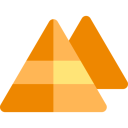

<div align="center">



# Djoser

**A native, Windows-first developer environment manager for PHP and Laravel.**

Per-project PHP runtimes, local HTTPS sites and services, without Docker, WSL or touching the PHP already on your machine.


[](https://github.com/Egyptus/Djoser/releases)

[Download for Windows](https://github.com/Egyptus/Djoser/releases/latest)

</div>

> Djoser is at an early stage. Expect changes between versions.

## Quick start

Install Djoser from the [latest release](https://github.com/Egyptus/Djoser/releases/latest). It installs for your user only and needs no administrator rights. Then, inside your project:

```powershell
djoser init
djoser up
```

`init` asks a few questions and writes a `djoser.yaml`. `up` downloads what the project needs, starts it, and prints its address:

```text
shop is up on PHP 8.5.12 (6 workers, ports 19000-19005)
  https://shop.localhost
```

## Describe a project

Everything a project needs lives in one file, so it starts the same way on any machine:

```yaml
name: shop
domain: shop.localhost
web-root: public
services:
  php:
    version: 8.5.12
    extensions: [redis, imagick, xdebug]
  mysql: 8.4.13
  node: 22.23.4
```

Edit the file and run `djoser up` to apply it. `djoser status` shows what changed since the last `up`.

Databases are shared between projects by default, with one database per project, on `127.0.0.1` only. To give a project its own server and data folder:

```yaml
services:
  mysql:
    version: 8.4.13
    data: D:/Data/shop-mysql
```

## Commands

| Command | What it does |
|---|---|
| `djoser init` | Create `djoser.yaml` for a project |
| `djoser up` / `down` | Start or stop the project |
| `djoser remove` | Stop it and forget it; files and data stay |
| `djoser status` | This project's state and pending changes |
| `djoser ps` | Every running project |
| `djoser exec <project> <tool>` | Run a tool inside a project, from anywhere |
| `djoser install <service> <version>` | Download a version |
| `djoser use <service> <version>` | Choose a version for this project; `--env` sets the default |
| `djoser list <service>` | What can be installed |
| `djoser runtimes` | What is installed |
| `djoser uninstall <service> <version>` | Remove a version; databases stay |
| `djoser install php-ext <name>` | Add a PHP extension to this project |
| `djoser trust` | Trust the local certificate for HTTPS |
| `djoser doctor` | Check this machine and explain how to fix problems |

## Your tools, in any folder

`php`, `composer`, `node`, `npm`, `npx`, `mysql`, `mysqldump` and `redis-cli` use the version your project asks for, and your default version elsewhere. Inside a running project, `mysql` and `redis-cli` connect to that project's services by themselves.

Add the folder Djoser tells you about to `PATH` once. Djoser never edits `PATH` for its tools.

## What runs today

| | |
|---|---|
| PHP | Official builds, one pool per version and set of extensions |
| PHP extensions | redis, imagick, memcached, xdebug, sqlsrv, pdo_sqlsrv, apcu, mongodb, amqp, and what ships with PHP |
| Composer, Node.js | Any folder, per-project versions |
| MySQL | 8.0, 8.4, 9.7 |
| Redis | 7.2, 7.4, 8.4, 8.10, from a community Windows build |
| Sites | Caddy, HTTPS on `*.localhost` |

Valkey, MariaDB, PostgreSQL, MongoDB, RustFS and Cloudflare tunnels are planned.

## This repository

It holds the installer in [Releases](https://github.com/Egyptus/Djoser/releases) and the tables in [`catalog/`](catalog), which list the versions Djoser may download and the SHA-256 of each file. Djoser reads them so that new versions can be added without a new release.
