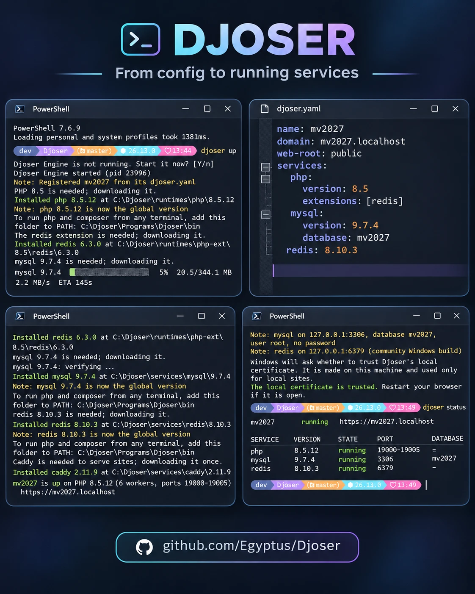
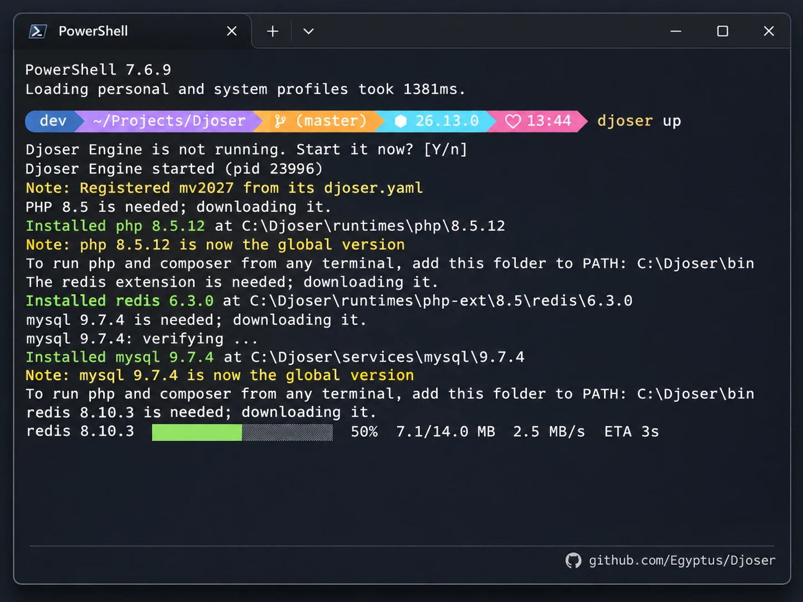
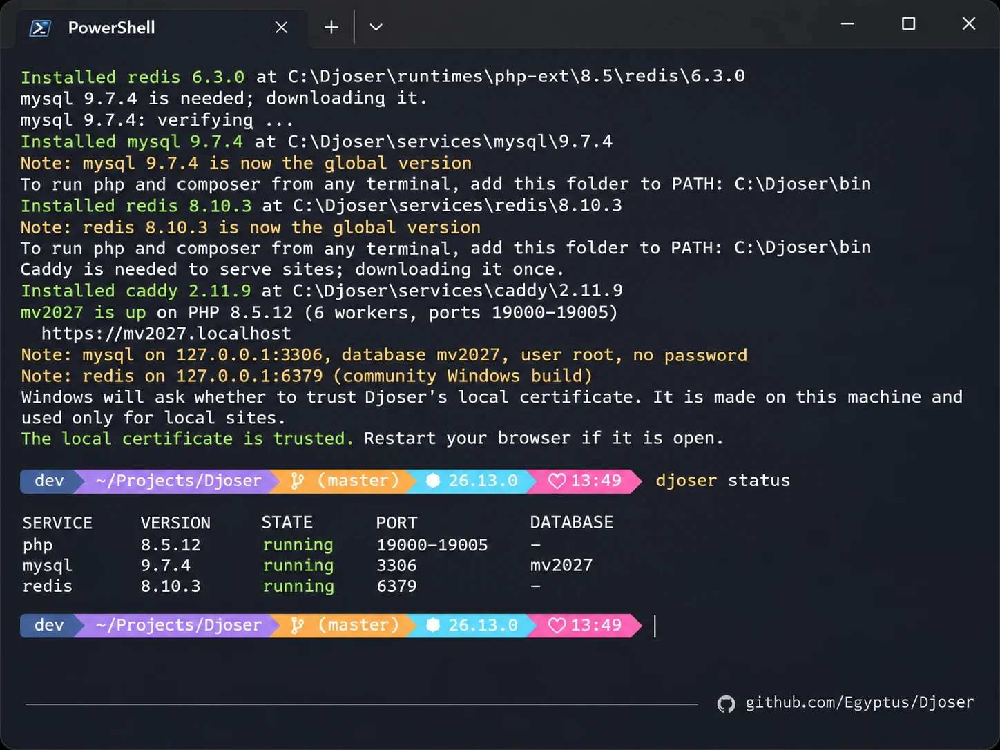
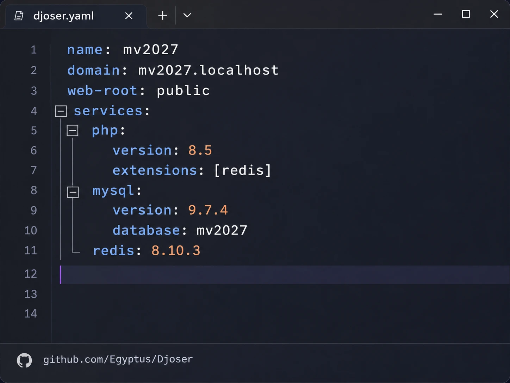
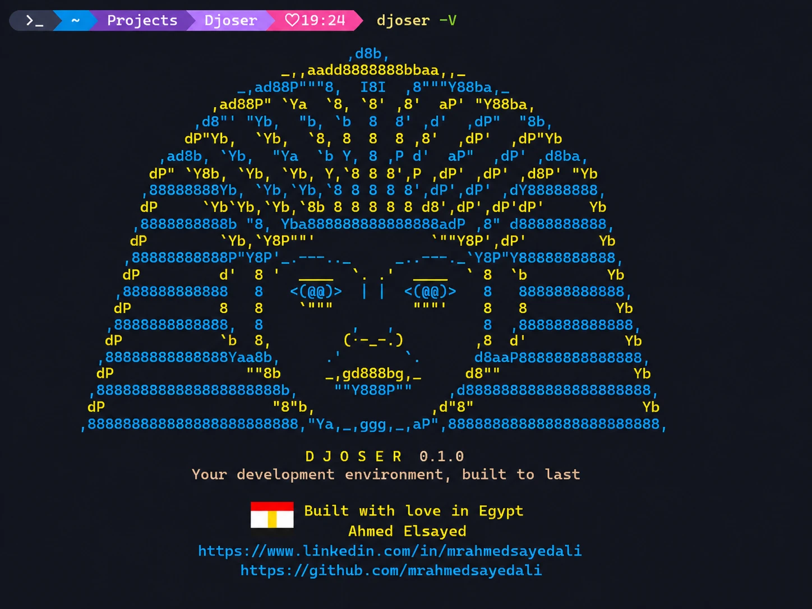

<div align="center">



**A native, Windows-first developer environment manager for PHP and Laravel.**

Per-project PHP, local HTTPS sites, MySQL and Redis, without Docker, WSL or touching the PHP already on your machine.


[](https://github.com/Egyptus/Djoser/releases)

### [Download for Windows](https://github.com/Egyptus/Djoser/releases/latest)

</div>

> Djoser is at an early stage. Expect changes between versions.

## Why Djoser

- **One file per project.** `djoser.yaml` says what a project needs, and `djoser up` makes it true.
- **Versions side by side.** Every project uses its own PHP, MySQL and Redis versions.
- **Real HTTPS.** Each project gets its own `https://name.localhost` address.
- **No administrator rights.** Djoser installs for your user only, and everything it downloads stays in one folder.
- **Your data stays.** `down`, `remove` and `uninstall` never delete a database.

## Install

Download the installer from the [latest release](https://github.com/Egyptus/Djoser/releases/latest) and run it. It offers two options:

| Option | Default | What it does |
|---|---|---|
| Add Djoser to `PATH` | On | `djoser` works in any new terminal |
| Add the tools to `PATH` | Off | `php`, `composer`, `node`, `mysql` and the others work in any new terminal. If another copy is already on `PATH`, the one listed first is used |

The installer is not signed yet, so Windows or your antivirus may warn before running it. Choose **More info**, then **Run anyway**, and compare the file with the SHA-256 in the release notes.

To update, run the new installer. It stops Djoser first and keeps your projects and databases.

## Create a Laravel project

This goes from nothing to a running site. To add Djoser to a project you already have, start at step 3 inside its folder.

### 1. Get PHP, Composer and Node.js

```powershell
djoser install php 8.5
djoser install composer latest
djoser install node 22
```

### 2. Create the project

```powershell
djoser composer create-project laravel/laravel shop
cd shop
```

### 3. Describe it

```powershell
djoser init --name shop --domain shop.localhost --root public --php 8.5 -y
```

Leave out the options and `init` asks for each one. With PHP it also writes a few PHP settings you can change. Then open `djoser.yaml` and add what the project needs:

```yaml
name: shop
domain: shop.localhost
web-root: public
services:
  php:
    version: 8.5
    extensions: [redis]
    ini:
      memory_limit: 512M
      upload_max_filesize: 64M
      post_max_size: 64M
      max_execution_time: 120
  mysql:
    version: 8.4
    database: shop
  redis: 8.4
```

`extensions: [redis]` is the PHP extension that talks to Redis. `redis: 8.4` is the Redis server itself. You need both.

### 4. Start it

```powershell
djoser up
```

The first run downloads what is missing, starts it, and offers to trust the local certificate so browsers accept the site.



It ends with the address and the connection details:

```text
shop is up on PHP 8.5.12 (6 workers, ports 19000-19005)
  https://shop.localhost
Note: mysql on 127.0.0.1:3306, database shop, user root, no password
Note: redis on 127.0.0.1:6379 (community Windows build)
```

### 5. Connect Laravel

Djoser does not edit `.env`. Copy the values `up` printed:

```env
DB_CONNECTION=mysql
DB_HOST=127.0.0.1
DB_PORT=3306
DB_DATABASE=shop
DB_USERNAME=root
DB_PASSWORD=

REDIS_CLIENT=phpredis
REDIS_HOST=127.0.0.1
REDIS_PORT=6379

CACHE_STORE=redis
QUEUE_CONNECTION=redis
SESSION_DRIVER=redis
```

Projects using the same Redis version share one server, so give each project its own `REDIS_PREFIX`.

### 6. Prepare the app

```powershell
djoser artisan migrate
djoser npm install
djoser npm run build
```

Open `https://shop.localhost`.

### 7. Run the background work

Each of these stays open, so give it its own terminal:

```powershell
djoser artisan queue:work
djoser artisan schedule:work
djoser npm run dev
```

## See what is running

```powershell
djoser status
```



`djoser status` also shows what changed in `djoser.yaml` since the last `up`. `djoser ps` lists every running project.

## Describe a project



Edit the file and run `djoser up` to apply it. A version can be a line such as `8.5` or an exact one such as `8.5.12`.

| Key under a service | What it does |
|---|---|
| `version` | The version to run |
| `extensions` | PHP extensions, such as `[redis, imagick, xdebug]` |
| `database` | The database name; by default the project's name, with `-` turned into `_` |
| `port` | Run a separate server for this project on this port |
| `data` | Run a separate server with its data in this folder, which must exist |
| `dedicated: true` | Run a separate server for this project |
| `ini` | PHP settings for this project, one per line, such as `memory_limit: 1G` |

To change PHP settings from the terminal:

```powershell
djoser config php memory_limit=1G,upload_max_filesize=200M
djoser config php
```

The first writes them to `djoser.yaml` and restarts the project's PHP if it is running; an empty value, such as `memory_limit=`, removes one. The second lists them.

Servers are shared between projects by default, with one database per project, on `127.0.0.1` only. A separate server starts with empty data.

## Open the database

```powershell
djoser tool db
```

Opens [HeidiSQL](https://www.heidisql.com/) on this project's database, downloading it the first time. In the terminal, `djoser mysql` and `djoser redis-cli` connect to the project's services by themselves.

## Share your site

```powershell
djoser share
```

Prints a temporary public address through Cloudflare, with no account needed, while the command runs. Anyone with the address can open the site. Press Ctrl+C to stop.

For Laravel, set `APP_URL` to that address and trust proxies, or styles and links may break.

## Commands

| Project | |
|---|---|
| `djoser init` | Create `djoser.yaml` |
| `djoser up` / `down` | Start or stop the project |
| `djoser status` | Its services and pending changes |
| `djoser config php key=value,...` | Show or change the project's PHP settings |
| `djoser remove` | Stop it and forget it; files and data stay |
| `djoser ps` | Every running project |
| `djoser exec <project> <tool>` | Run a tool inside a project, from anywhere |
| `djoser tool db` | Open HeidiSQL on the project's database |
| `djoser share` | A temporary public address, until Ctrl+C |

| Tools | |
|---|---|
| `djoser php`, `composer`, `artisan` | Run with the project's PHP |
| `djoser node`, `npm`, `npx` | Run with the project's Node.js |
| `djoser mysql`, `mysqldump`, `redis-cli` | Connect to the project's services |

| Versions | |
|---|---|
| `djoser list <service>` | What can be installed |
| `djoser install <service> <version>` | Download a version |
| `djoser install heidisql`, `cloudflared` | Download a helper program ahead of time |
| `djoser install php-ext <name>` | Add a PHP extension to this project |
| `djoser use <service> <version>` | Choose a version for this project; `--env` sets the default |
| `djoser runtimes` | What is installed |
| `djoser uninstall <service> <version>` | Remove a version; databases stay |

| Machine | |
|---|---|
| `djoser trust` | Trust the local certificate for HTTPS |
| `djoser doctor` | Check this machine and explain how to fix problems |

## What runs today

| | |
|---|---|
| PHP | Official builds, one pool per version and set of extensions |
| PHP extensions | redis, imagick, memcached, xdebug, sqlsrv, pdo_sqlsrv, apcu, mongodb, amqp, and what ships with PHP |
| Composer, Node.js | Per-project versions, in any folder |
| MySQL | 8.0, 8.4, 9.7 |
| Redis | 7.2, 7.4, 8.4, 8.10, from a community Windows build |
| Sites | Caddy, HTTPS on `*.localhost` |
| Helpers | HeidiSQL, cloudflared |

Valkey, MariaDB, PostgreSQL, MongoDB and RustFS are planned.

## This repository

It holds the installer in [Releases](https://github.com/Egyptus/Djoser/releases) and the tables in [`catalog/`](catalog), which list the versions Djoser may download and the SHA-256 of each file. Djoser reads them so that new versions can be added without a new release.

<div align="center">



</div>
